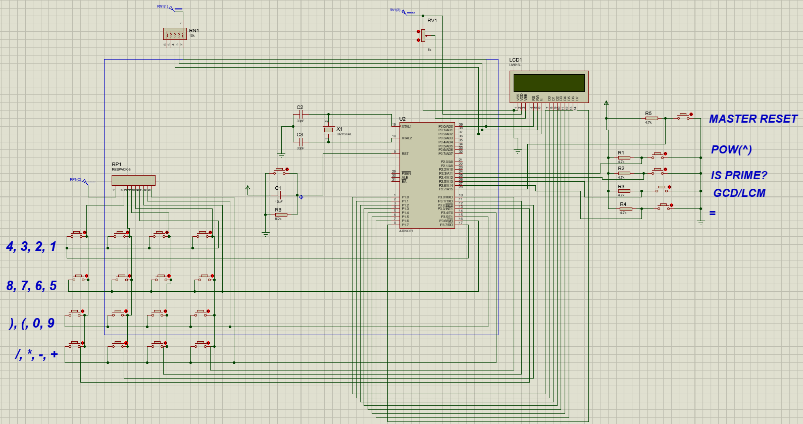
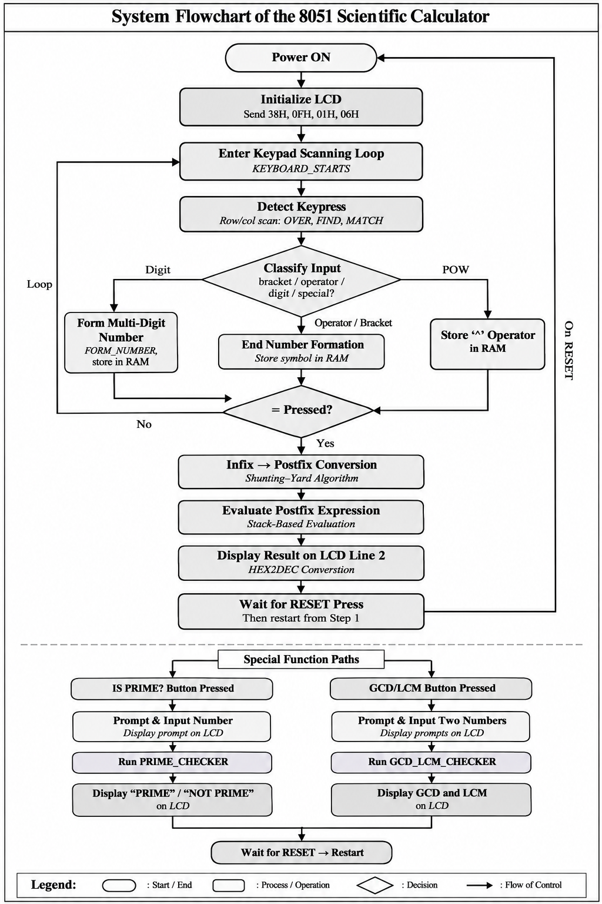
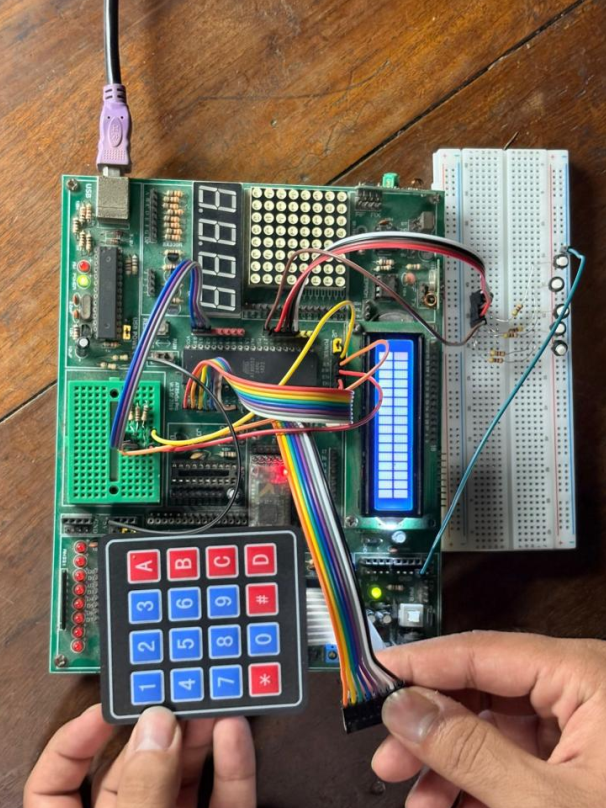

# 8051 Microcontroller-Based Scientific Calculator

An assembly-language-based scientific calculator developed using the **8051 microcontroller architecture**, featuring arithmetic expression evaluation, operator precedence handling, prime-number checking, GCD/LCM calculation, and an interactive keypad–LCD interface.

The project integrates low-level microcontroller programming, algorithmic expression processing, and hardware interfacing through Proteus simulation.

---

## 1. Project Overview

This project presents the design and implementation of a microcontroller-based scientific calculator using the **AT89C51 (8051-family) microcontroller** and assembly language.

Unlike a basic calculator that processes only one arithmetic operation at a time, this implementation incorporates an expression evaluation mechanism capable of handling multiple operators and parentheses according to operator precedence.

The calculator uses a **4×4 matrix keypad** for numerical and arithmetic input, dedicated push buttons for additional functions, and a **16×2 LCD** to display entered expressions and calculated results.

The project combines several important embedded-system concepts, including:

- 8051 assembly-language programming
- Microcontroller port configuration and interfacing
- Matrix keypad scanning and input detection
- LCD command and data communication
- Internal RAM management and register-bank utilization
- Stack-based expression processing
- Arithmetic and number-theoretic algorithms

The circuit is designed and simulated in **Proteus Design Suite**, with the application logic implemented in assembly language and compiled into an Intel HEX firmware file.

## 2. Project Objectives

The primary objectives of this project are:

1. Design a functional scientific calculator using an 8051-family microcontroller.
2. Implement a keypad-based input system for numerical values and arithmetic operators.
3. Interface a 16×2 LCD to display user inputs and computation results.
4. Develop assembly-language routines for arithmetic operations and additional mathematical functions.
5. Implement operator precedence and parentheses handling through infix-to-postfix conversion.
6. Evaluate postfix expressions using stack-based processing.
7. Integrate the software and hardware components into a complete Proteus simulation.

## 3. Key Features

### 3.1 Arithmetic Operations

The calculator implements the following arithmetic operations:

| Operation | Symbol | Implementation |
|---|---|---|
| Addition | `+` | 8051 addition instruction |
| Subtraction | `-` | Subtraction with borrow |
| Multiplication | `*` | 8051 multiplication instruction |
| Division | `/` | 8051 division instruction |
| Exponentiation | `^` | Lookup-table-based square and cube calculation |

Arithmetic expressions are processed through an infix-to-postfix conversion stage before evaluation.

### 3.2 Operator Precedence and Parentheses

The calculator supports expressions containing multiple operators and parentheses.

The implementation assigns precedence values to arithmetic operators:

| Operators | Precedence |
|---|---|
| `+`, `-` | 1 |
| `*`, `/` | 2 |
| `^` | 3 |

Parentheses are processed separately during infix-to-postfix conversion.

This mechanism allows the calculator to evaluate expressions according to the implemented operator precedence rules rather than simply processing operators in their input order.

### 3.3 Additional Mathematical Functions

**Prime-number checking**

A dedicated routine determines whether an entered number is prime by performing repeated integer division and checking the remainder.

The result is displayed on the LCD as either:

- `PRIME NUMBER`
- `NOT PRIME NUMBER`

**Greatest Common Divisor (GCD)**

The calculator implements a remainder-based iterative algorithm to determine the greatest common divisor of two input numbers.

**Least Common Multiple (LCM)**

The least common multiple is calculated using the relationship:

LCM(a, b) = (a × b) / GCD(a, b)

The GCD and LCM results are displayed on separate LCD lines.

The numerical range of these operations is constrained by the 8-bit arithmetic implementation.

## 4. Hardware Components and Interfacing

The calculator consists of the following principal components:

| Component | Function |
|---|---|
| AT89C51 microcontroller | Executes the assembly-language calculator program |
| 4×4 matrix keypad | Provides numerical and arithmetic input |
| 16×2 LCD | Displays expressions, prompts, and results |
| Dedicated push buttons | Select additional functions, evaluation, and reset |
| Supporting circuit components | Provide the required electrical connections and simulation setup |

### 4.1 Microcontroller Port Configuration

The assembly program uses the following port assignments:

| Microcontroller Port | Function |
|---|---|
| Port 0, bit 0 (`P0.0`) | LCD Register Select (`RS`) |
| Port 0, bit 1 (`P0.1`) | LCD Read/Write (`RW`) |
| Port 0, bit 2 (`P0.2`) | LCD Enable (`E`) |
| Port 1 (`P1`) | LCD data interface |
| Port 2, bits 3–7 (`P2.3`–`P2.7`) | Dedicated function buttons |
| Port 3 (`P3`) | Matrix keypad interface |

### 4.2 Keypad Interface

The 4×4 keypad is interfaced through Port 3 of the microcontroller.

The program scans the keypad rows and columns to identify the pressed key. Each detected key is mapped to its corresponding ASCII character using predefined lookup tables.

The keypad contains:

- Decimal digits `0–9`
- Arithmetic operators `+`, `-`, `*`, `/`
- Opening and closing parentheses `(` and `)`

Additional operations are accessed using dedicated push buttons.

### 4.3 Dedicated Function Buttons

The following functions are assigned to Port 2:

| Pin | Function |
|---|---|
| `P2.3` | Exponentiation |
| `P2.4` | Prime-number checking |
| `P2.5` | GCD/LCM |
| `P2.6` | Evaluate expression (`=`) |
| `P2.7` | Reset calculator |

The firmware uses polling and delay-based debouncing for input detection.

### 4.4 LCD Interface

A 16×2 LCD is used to display user inputs, mathematical prompts, and calculated results.

The assembly implementation includes separate routines for:

- Sending LCD commands
- Writing characters
- Checking LCD readiness
- Generating delays
- Converting numerical results into decimal digits for display

## 5. System Architecture and Working Principle

The calculator operates through a sequence of input acquisition, expression processing, numerical computation, and result display.

The general system workflow is:

```text
              Start / Reset
                    |
                    v
         Initialize Microcontroller
             and LCD Interface
                    |
                    v
             Scan Keypad and
             Function Buttons
                    |
                    v
           Identify User Input
                    |
          +---------+---------+
          |                   |
          v                   v
   Arithmetic Input      Special Function
          |                   |
          v                   v
   Store Expression      Prime / GCD-LCM
     in Internal RAM        Processing
          |                   |
          v                   |
   Infix-to-Postfix           |
      Conversion              |
          |                   |
          v                   |
   Postfix Evaluation         |
          |                   |
          +---------+---------+
                    |
                    v
            Format Result
                    |
                    v
             Display on LCD
                    |
                    v
            Wait for Reset
```

### 5.1 Input Acquisition

The program continuously monitors the keypad and dedicated push buttons.

Each valid key press is identified and processed according to its type.

Numerical digits are combined to form operands, while operators and parentheses are stored separately in internal RAM.

### 5.2 Expression Storage

The calculator uses internal RAM locations to store the entered expression.

The assembly implementation begins storing expression elements from address `30H`.

During expression evaluation, a separate region beginning at `50H` is used for the postfix representation.

### 5.3 Expression Evaluation

When the evaluation button is pressed, the program determines whether the requested operation is:

- Prime-number checking
- GCD/LCM calculation
- Standard arithmetic expression evaluation

Standard arithmetic expressions undergo infix-to-postfix conversion followed by stack-based evaluation.

The computed result is subsequently converted into a displayable decimal representation and sent to the LCD.

## 6. Infix-to-Postfix Conversion

One of the main algorithmic components of this project is the implementation of infix-to-postfix expression conversion in 8051 assembly language.

### 6.1 Infix Notation

Infix notation places operators between operands.

For example:

```text
2 + 3 * 4
```

Because multiplication has higher precedence than addition, the multiplication operation must be evaluated first.

### 6.2 Postfix Notation

In postfix notation, operators appear after their operands.

The equivalent postfix expression is:

```text
2 3 4 * +
```

Postfix notation is particularly suitable for stack-based evaluation because explicit parentheses and repeated precedence comparisons are no longer required during the evaluation stage.

### 6.3 Conversion Algorithm

The assembly program implements a stack-based conversion procedure based on the Shunting-Yard approach.

The general procedure is:

1. Read the next element of the infix expression.
2. If the element is an operand, append it to the postfix expression.
3. If the element is an opening parenthesis, push it onto the operator stack.
4. If the element is a closing parenthesis, pop operators until the corresponding opening parenthesis is encountered.
5. If the element is an operator, compare its precedence with the operators already on the stack.
6. Transfer operators from the stack to the postfix expression according to the implemented precedence rules.
7. Continue until all expression elements have been processed.
8. Pop the remaining operators to complete the postfix expression.

This conversion separates operator-order handling from numerical computation.

## 7. Postfix Expression Evaluation

After conversion, the postfix expression is evaluated using a stack.

The general procedure is:

1. Read the next postfix element.
2. If the element is an operand, push it onto the stack.
3. If the element is an operator, pop the required operands.
4. Perform the corresponding arithmetic operation.
5. Push the intermediate result back onto the stack.
6. Continue until all postfix elements have been processed.
7. Retrieve the final result from the stack.

For example:

```text
Postfix Expression: 2 3 4 * +

Push 2
Push 3
Push 4

Apply *:
3 × 4 = 12

Push 12

Apply +:
2 + 12 = 14

Final Result = 14
```

The implementation uses dedicated assembly subroutines for addition, subtraction, multiplication, division, and exponentiation.

## 8. Assembly-Language Implementation

The calculator firmware is implemented in 8051 assembly language.

### 8.1 Register and Memory Management

The program uses internal RAM, general-purpose registers, the accumulator, the B register, and the stack pointer to manage user input and calculations.

Different register banks are selected where required to support temporary storage and processing routines.

### 8.2 Arithmetic Subroutines

The implementation contains dedicated routines corresponding to the following operations:

| Assembly Routine | Function |
|---|---|
| `ADD_MODULE` | Addition |
| `SUB_MODULE` | Subtraction |
| `MUL_MODULE` | Multiplication |
| `DIV_MODULE` | Division |
| `POW_MODULE` | Exponentiation |
| `PRIME_CHECKER` | Prime-number checking |
| `GCD_LCM_CHECKER` | GCD and LCM calculation |
| `HEX2DEC` | Decimal digit extraction for display |

### 8.3 Exponentiation Using Lookup Tables

Exponentiation is implemented using predefined lookup tables for squares and cubes.

The assembly source includes:

- `SQUARE_DATA`
- `CUBE_DATA`

The routine selects the corresponding table according to the exponent and retrieves the result using indexed program-memory access.

This approach avoids implementing a general-purpose exponentiation algorithm on the microcontroller.

### 8.4 Decimal Result Formatting

The `HEX2DEC` routine separates an 8-bit numerical value into hundreds, tens, and units digits through successive division by ten.

These digits are converted to ASCII characters and transmitted to the LCD.

The arithmetic result display also contains a separate branch for negative values.

## 9. Proteus Circuit Design and Simulation

The complete calculator circuit was developed using Proteus Design Suite.

The Proteus project integrates:

- AT89C51 microcontroller
- Matrix keypad
- LCD display
- Dedicated function buttons
- Supporting circuit connections
- Compiled HEX firmware

### 9.1 Complete Circuit Schematic



The schematic illustrates the electrical connections between the microcontroller, keypad, LCD, and dedicated control buttons.

### 9.2 Simulation Procedure

The simulation is operated by loading the compiled HEX firmware into the AT89C51 microcontroller and running the Proteus project.

Users can then enter numerical expressions using the keypad and select additional functions through the dedicated buttons.

The LCD displays the corresponding input, prompts, and calculated results.

## 10. Results and Demonstrations

The project demonstrates the integration of assembly-language algorithms with a simulated microcontroller-based user interface.

The principal functions include:

- Arithmetic expression entry and evaluation
- Operator precedence handling
- Parenthesized expression processing
- Prime-number checking
- GCD and LCM calculation
- LCD-based result presentation

### 10.1 System Workflow



### 10.2 Hardware Implementation



The project report provides further implementation details and supporting figures.

## 11. Technologies and Tools

| Category | Technology |
|---|---|
| Microcontroller | AT89C51 (8051 family) |
| Programming language | 8051 Assembly |
| Circuit design and simulation | Proteus Design Suite |
| Firmware format | Intel HEX |
| User input | 4×4 matrix keypad and push buttons |
| Display | 16×2 LCD |
| Algorithms | Infix-to-postfix conversion, stack-based evaluation, prime checking, GCD/LCM |

## 12. How to Run the Project

### Prerequisites

To run the project, you will need:

- Proteus Design Suite with support for the AT89C51 microcontroller
- The supplied Proteus project file
- The compiled HEX firmware

An 8051-compatible assembler is required only if you intend to modify and rebuild the assembly source.

### Step 1: Clone the Repository

```bash
git clone https://github.com/mashrursaademad/8051-scientific-calculator.git
```

Navigate to the repository:

```bash
cd 8051-scientific-calculator
```

### Step 2: Open the Proteus Project

Open the following file in Proteus:

```text
proteus/Calculator_v1.1.pdsprj
```

### Step 3: Configure the Microcontroller Firmware

Open the AT89C51 component properties and verify that the program file points to:

```text
firmware/calculatorv3.4.hex
```

If Proteus does not automatically resolve the firmware path, browse to the HEX file manually.

### Step 4: Run the Simulation

Start the Proteus simulation.

The LCD should initialize, and the calculator should be ready to accept input.

### Step 5: Perform Calculations

Use the keypad to enter numerical values, arithmetic operators, and parentheses.

Use the dedicated push buttons to select exponentiation, prime checking, GCD/LCM, evaluation, or reset.

The calculated result will be displayed on the LCD.

### Modifying the Assembly Program

The editable assembly source is available at:

```text
src/calculatorv3.4.asm
```

After modifying the source, assemble it using a compatible 8051 assembler, generate an updated HEX file, and configure Proteus to use the rebuilt firmware.

## 13. Project Structure

```text
8051-scientific-calculator/
│
├── README.md
├── .gitignore
│
├── src/
│   └── calculatorv3.4.asm
│
├── firmware/
│   └── calculatorv3.4.hex
│
├── proteus/
│   └── Calculator_v1.1.pdsprj
│
├── documentation/
│   └── EEE4706_Project_Report.pdf
│
└── results/
    └── figures/
        ├── circuit_schematic.png
        ├── system_flowchart.png
        └── hardware_implementation.png
```

## 14. Documentation

The complete academic project report is available below:

[8051 Scientific Calculator — Project Report (PDF)](documentation/EEE4706_Project_Report.pdf)

The report contains the project background, circuit design, algorithm descriptions, implementation details, and supporting results.

## 15. Challenges and Limitations

The project involves several practical challenges associated with implementing a calculator using an 8-bit microcontroller.

### 15.1 Assembly-Level Expression Processing

Implementing operator precedence, parentheses, and postfix evaluation requires explicit memory management, stack operations, and control-flow handling.

These mechanisms are implemented directly in assembly language rather than through high-level programming libraries.

### 15.2 Limited Numerical Range

The calculator relies primarily on 8-bit arithmetic operations.

Although multiple decimal digits can be entered, numerical values and intermediate results are constrained by the available 8-bit representation.

Arithmetic overflow is not comprehensively handled.

### 15.3 Exponentiation Constraints

Exponentiation is implemented through square and cube lookup tables rather than a general exponentiation routine.

Consequently, supported exponent values and bases are limited by the lookup-table implementation.

### 15.4 Input Validation and Exceptional Cases

The program assumes valid input sequences for several operations.

Certain boundary cases, including invalid expressions, division by zero, and small inputs to the prime-checking routine, are not comprehensively handled.

### 15.5 Simulation Scope

The Proteus project demonstrates the circuit and firmware behavior in a simulated environment.

Actual hardware operation may require additional validation of timing, electrical characteristics, and peripheral interfacing.

## 16. Contributors and Individual Contributions

### 16.1 Contributors

This project was developed as a group academic project for:

**Course:** EEE 4706 - Microcontroller Based System Design Lab
**Institution:** Islamic University of Technology (IUT)  
**Date of Submission:** April 20, 2026

**Team Members:**

- Ahmed Fatin Jawad
- Mashrur Saad Emad
- Faisal Abrar Chowdhury
- Ahmed Awil Mohamoud
- Bello Aminu Ado

Refer to the accompanying project report for the complete contributor list and academic details.

### 16.2 Individual Contribution

**Mashrur Saad Emad**

**Circuit Design and Simulation**: Proteus circuit schematic design

**Algorithm Implementation**
- Infix-to-postfix conversion
- Postfix expression evaluation
- Exponentiation functionality
- GCD and LCM calculation

**Output Interface**: Result display logic

**Documentation**: Project report preparation

## 17. Repository Maintainer

**Mashrur Saad Emad**  
Electrical and Electronic Engineering Graduate  
Islamic University of Technology (IUT)

[GitHub Profile](https://github.com/mashrursaademad)  
[LinkedIn Profile](https://www.linkedin.com/in/mashrur-saad-emad-787995436/)

---

*This repository documents an undergraduate embedded-systems project developed for academic learning and demonstration purposes.*
